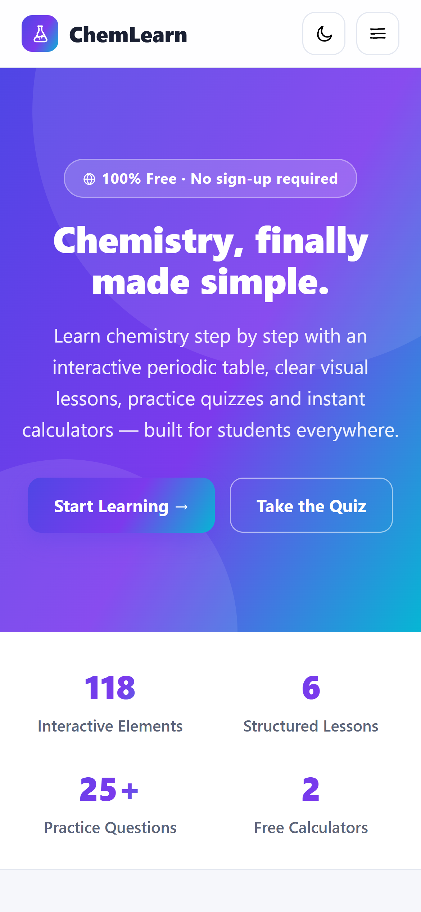
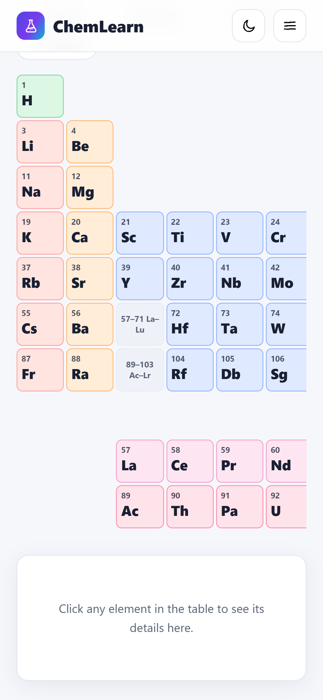
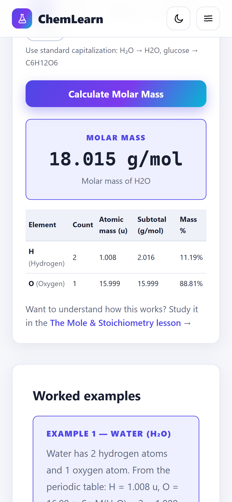

# ChemLearn 🧪

**Free chemistry study app for students** — https://chem.chuliudev.com

An interactive periodic table with all 118 elements, six structured lessons
with worked examples, a practice quiz with explanations, and four chemistry
calculators (molar mass, mole conversion, pH, ideal gas law) that show a
full breakdown of every result.

## Features

- 🧪 Interactive periodic table — tap any of the 118 elements
- 📚 Six lessons with worked examples and key takeaways
- ✏️ 25-question quiz with instant feedback and explanations
- 🧮 Four calculators that show their work (element-by-element breakdowns)
- 📄 One-page printable formula cheat sheet
- 📴 Works offline — everything is bundled in the app
- 🆓 No ads, no sign-up, no paywall

## Download

Android APK (3.2 MB, Android 7.0+): **https://chem.chuliudev.com/download**

## Screenshots

| Home | Periodic Table | Molar Mass Calculator |
|---|---|---|
|  |  |  |

## Privacy

No data collection, no tracking. Privacy policy: https://chem.chuliudev.com/privacy

## Contact

Issues and suggestions: use GitHub Issues, or the support email on the store listing.
